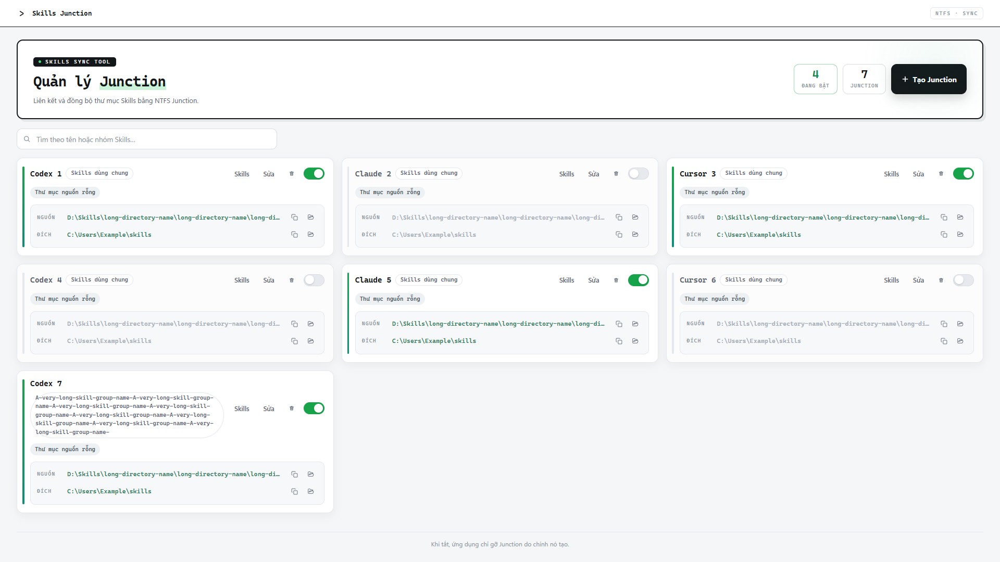

# Skills Junction

[](https://github.com/datG227/skills-junction/actions/workflows/ci.yml)
[](https://github.com/datG227/skills-junction/releases/latest)
[](LICENSE)

Ứng dụng Windows giúp dùng chung thư mục Skills giữa nhiều công cụ bằng NTFS Junction. Quản lý các cặp thư mục, bật/tắt cả nhóm hoặc từng skill trong một cửa sổ.

[Tải bản mới nhất](https://github.com/datG227/skills-junction/releases/latest) · [Hướng dẫn phát triển](docs/development.md) · [Báo lỗi](https://github.com/datG227/skills-junction/issues)



## Tải và chạy

1. Mở **Releases**, tải `SkillsJunction-v<version>-win-x64.zip`.
2. Giải nén toàn bộ ZIP vào một thư mục riêng.
3. Chạy `SkillsJunction.WebView2.exe` trong thư mục vừa giải nén.

Yêu cầu Windows 10/11 x64, [.NET 10 Desktop Runtime](https://dotnet.microsoft.com/en-us/download/dotnet/10.0) và [Microsoft Edge WebView2 Runtime](https://developer.microsoft.com/en-us/microsoft-edge/webview2/#download). Bản phát hành không đóng gói sẵn hai runtime này.

Mỗi bản phát hành mới từ quy trình build có `SHA256SUMS.txt`. Có thể đối chiếu mã SHA-256 của ZIP bằng:

```powershell
Get-FileHash .\SkillsJunction-v1.0.1-win-x64.zip -Algorithm SHA256
```

## Sử dụng

Tạo cặp thư mục với **nguồn** là nơi chứa các skill và **đích** là nơi cần dùng chúng. Bật cặp để tạo Junction. Mở **Skills** để xem danh sách hai cột và dùng công tắc cạnh tên skill.

Khi tạo hoặc sửa Junction, bấm ra ngoài hộp thoại hoặc nhấn Escape không làm mất biểu mẫu đang nhập. Dùng nút **×** hoặc **Hủy** để đóng; lưu thành công cũng tự đóng hộp thoại.

Nút copy cạnh mỗi công tắc sao chép đường dẫn đầy đủ tới thư mục nguồn của skill, kể cả khi skill đang tắt hoặc công tắc bị khóa. Dán đường dẫn đó cho công cụ AI đọc khi cần.

- **Tắt skill:** gỡ Junction do ứng dụng quản lý, giữ nguyên thư mục nguồn và ghi nhớ lựa chọn. Bật lại nhóm hoặc mở lại ứng dụng không tạo lại skill đã tắt.
- **Bật skill:** cho phép tạo lại Junction riêng của skill đó khi nhóm được bật.
- **Công tắc mờ:** mục ở đích đã có sẵn hoặc đã đổi nguồn; ứng dụng giữ nguyên mục đó.
- **Đồng bộ:** thêm Junction cho skill mới xuất hiện ở nguồn mà không cần tắt rồi bật lại cặp. Nút chỉ hoạt động khi cặp đang bật; skill đã tắt và mục có sẵn ở đích được giữ nguyên. Cặp đang tắt không tự bật khi đồng bộ.
- **Link hỏng / nguồn mất:** thẻ cảnh báo khi Junction trỏ tới thư mục nguồn đã bị xóa, hoặc khi không còn thư mục nguồn. Ứng dụng chỉ báo, không tự xóa các link này.

Cấu hình được lưu ở `%LOCALAPPDATA%\SkillsJunction\pairs.json`; bản sao lưu của lần ghi trước nằm ở `pairs.json.bak` cùng thư mục. Nhật ký khởi động nằm ở `%LOCALAPPDATA%\SkillsJunction\WebView2.log`.

## Build từ mã nguồn

Cần Windows, .NET 10 SDK và Windows PowerShell 5.1. Node.js 22 trở lên và Python 3.13 trở lên dùng cho các bước kiểm tra.

```powershell
git clone git@github.com:datG227/skills-junction.git
cd skills-junction
powershell -NoProfile -ExecutionPolicy Bypass -File scripts/build.ps1
.\artifacts\publish\SkillsJunction.WebView2.exe
```

Script khôi phục NuGet theo lockfile, build và xuất ứng dụng vào `artifacts/publish`. Repo lưu mã nguồn, tài liệu và lockfile; EXE/DLL cùng dữ liệu người dùng không được commit.

Kiểm tra sau khi build:

```powershell
npm ci --ignore-scripts
npm run check
python -m unittest discover -s tests -v
npm run test:desktop
```

Các kiểm tra Junction và ứng dụng thật dùng thư mục tạm cùng hồ sơ cấu hình riêng. Xem [quy trình build, kiểm tra và phát hành](docs/development.md) để tạo ZIP hoặc dùng bản đóng gói trong kiểm tra.

## Cấu trúc dự án

```text
src/
  SkillsJunction.Desktop/  # Host C# WinForms + WebView2
  backend/                # Xử lý Junction bằng PowerShell
  web/                    # HTML, CSS và JavaScript
scripts/                  # Build và đóng gói ZIP
tests/                    # Backend, đóng gói và ứng dụng thật
docs/                     # Thiết kế, ảnh và hướng dẫn phát triển
.github/                  # CI, phát hành và cập nhật dependency
```

Thay đổi được gửi qua pull request. GitHub Actions trên Windows chạy kiểm tra, build và tạo ZIP. Khi đẩy tag phiên bản mới, job phát hành chỉ chạy sau khi toàn bộ kiểm tra đạt và tải ZIP cùng checksum lên GitHub Releases.

Repo ban đầu được nhập từ gói ứng dụng đã biên dịch. Host C# hiện tại được dựng lại từ hành vi và giao thức của bản đó, có đối chiếu bằng ILSpy; đây không phải bộ source C# gốc được tác giả cung cấp. Tag và gói phát hành `v1.0.0` được giữ nguyên. Chi tiết nằm trong [tài liệu phát triển](docs/development.md).

## Giấy phép

[MIT](LICENSE). Các thành phần bên thứ ba tuân theo giấy phép riêng của chúng.
